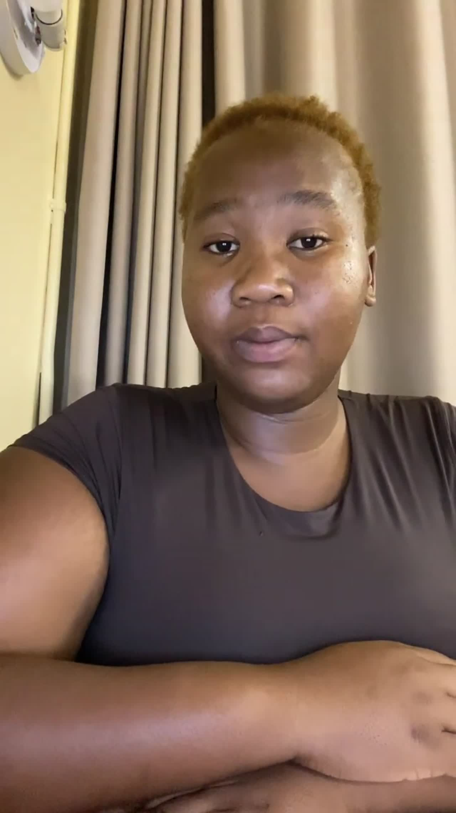

# Aliziwe Ncoko | UX/UI Designer

Final-year ICT (Multimedia Applications) student at CPUT, completed WIL at CAPACITI.

- **Portfolio:** https://ncokoaliziwe.github.io/Digital-Portfolio/
- **PRP370 evidence:** the "PRP370 Agile evidence" section of the portfolio page (charter, user stories and tasks, product backlog, sprint backlog and logbook, each with evidence and a reflection)
- **Contact:** 221171592@mycput.ac.za | 079 252 6142

## Files
- `index.html`: the whole portfolio on one page (about, work, PRP370 Agile evidence, experience, skills, mock interview, contact)
- `assets/`: styles, images and the interview video
- `assets/images/evidence/`: screenshots of the Agile Team Charter, Trello cards and board, and the Agile Logbook for Shezz-App

